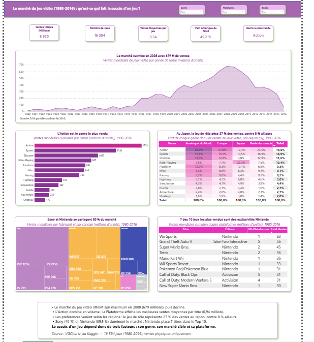

Ce dashboard Power BI analyse les ventes de plus de 16 000 jeux vidéo sortis entre 1980 et 2016 pour répondre à une question :
qu’est-ce qui fait le succès d’un jeu ? Il étudie le marché sous quatre angles : l’évolution des ventes dans le temps, 
les genres les plus vendus, les différences de goûts entre régions et le poids des constructeurs et des jeux phares. 
Des filtres permettent d’explorer les données par genre, plateforme et année.

L’analyse montre que le marché a atteint son pic en 2008. L’Action est le genre le plus vendu en volume, alors que le jeu 
de plateforme se vend le mieux par titre. Le Japon se distingue par sa préférence pour le jeu de rôle. Sony et Nintendo 
dominent le marché avec deux stratégies différentes, l’exclusivité et le multi-plateforme. Le succès d’un jeu dépend donc 
de son genre, de son public cible et de sa plateforme.

Les données proviennent du jeu de données Video Game Sales publié sur Kaggle.

